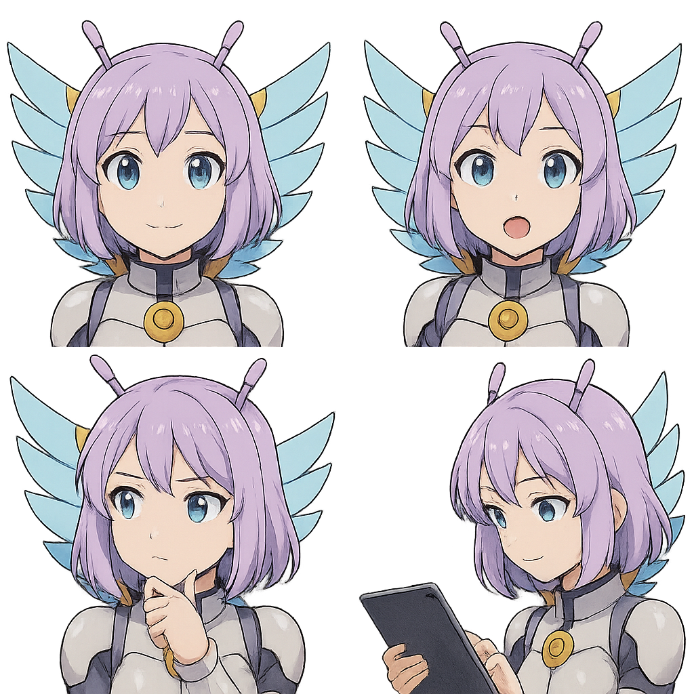

# First Steps

If you have not already done so, you should first complete the [Getting Started](./index.md) guide. This guide will help you set up your AI and get you started with the basics.

Once you have completed the setup, you can start using the AI in-game. The AI can help you with a variety of tasks, such as navigating the galaxy map, managing your ship's systems, and providing information about the game world. The AI can also assist you in combat, mining, trading, and other activities.

There are several configuration options, that you can adjust to customize the AI to your liking.

## Character Prompt

The AI Character Prompt is a description of the AI's personality. You can modify this text to your liking – if you want the AI to talk about your ships cat, you can mention "We have a cat on our ship that likes to get in the way of my controls when it wants attention.", causing the AI to role-play and mention the cats current whereabouts regularly. More examples can be found on our discord server.

## Audio

The integration uses your microphone for speech recognition. We support voice activation and push-to-talk (PTT). When using voice activation, we recommend using headphones to avoid the AI hearing itself, which causes a feedback loop.

### Name-triggered dialogue

Choose **Name-triggered Dialogue** under **Microphone Mode** in the general or advanced audio settings. The existing microphone modes, including Push-to-Talk, are unchanged. Start or restart the assistant after changing the microphone mode or activation settings.

Set an **activation name** (initially `Simone`) and an **inactivity timeout** (initially 10 seconds). Say the name at the beginning of a phrase:

- "Simone, plot a route to Sol."
- "Simone?" on its own, then wait for an acknowledgment before giving a command.
- Optionally precede the name with a configured prefix: by default, "Hey, Simone", "OK, Simone", "Okay, Simone" or "Dis, Simone", with or without a command in the same phrase.

Activation is not restricted to French. Use your configured name on its own or with a configured prefix; recognition depends on your STT provider and its language settings. Commands can be spoken in a language supported by your configured STT.

Once the dialogue is active, give follow-up commands without repeating the name. The timeout starts after the assistant finishes responding, including voice playback, and renews after each exchange. It does not cut off speech or processing already in progress. An inactivity timeout returns silently to standby.

To close the session explicitly, say a configured closing phrase as a complete utterance. Default phrases include "that's all", "I'm done" and "I am done" in English, and "ça sera tout" and "j'ai terminé" in French. You can edit or translate these phrases in the external phrase file described below.

Calling the name alone produces a short readiness acknowledgment; explicitly closing the session produces a short confirmation. These direct acknowledgments use your configured TTS voice without an LLM request. English is the default, with French equivalents also provided in the phrase file. With TTS disabled, acknowledgments are shown as text and a warning explains why no voice was played.

A badge in the application and visible overlays distinguishes **Standby**, **Dialogue active** and recognition errors. Game-event reactions and typed input continue to work outside voice sessions. Closing a session stops admission of new voice commands; it does not cancel game actions already started.

This mode **replaces the required-word filter** rather than adding another filter. The old required-word value is preserved for other microphone modes. Unlike a session, the old filter requires its text in every phrase and checks it only after transcription.

#### Customizing voice phrases

Invocation prefixes, closing phrases and direct acknowledgments are loaded from [src/data/voice_phrases.json](../src/data/voice_phrases.json), not embedded in the Python code. This file is also bundled with the packaged backend, in its `data` directory alongside the quest catalog. Its `default_language` is `en`, and `languages` contains separate `en` and `fr` objects.

| JSON field | Purpose |
|---|---|
| `invocation_prefixes` | Optional words before the configured name. An empty list adds no prefixes for that language. |
| `closing_phrases` | Complete utterances that close the dialogue. |
| `wake_acknowledgments` | Responses to calling the name without a command; one is chosen randomly. |
| `close_acknowledgments` | Confirmations of explicit closing; one is chosen randomly. |
| `language_names` (optional) | Names or aliases for an explicit TTS/STT language setting, such as `English` or `French`. Language codes work without aliases. |

Edit the UTF-8 JSON lists under `languages.en` or `languages.fr`, or add another language using its lowercase ISO 639-1 code, then restart the assistant. All four fields are required for each language. Each entry must be a string containing at least one letter or number; all lists except `invocation_prefixes` must be non-empty. The default language must have its own entry. Invalid or missing files produce an explicit startup error rather than falling back to hard-coded phrases. Recognition ignores case, accents and punctuation, but closing phrases must still match the entire utterance. Prefix entries do not include the activation name, which remains configured in the audio settings.

All configured languages' prefixes and closing phrases are recognized, so users can speak more than one language during a dialogue. Acknowledgment language is selected in this order:

1. An explicit TTS language, from the provider's character-level `language` setting or the TTS model's configured language.
2. An explicit language configured in the main STT.
3. Automatic local detection from accepted command text, if a compatible detector plugin is installed. A closing phrase identifies its language directly from the catalog, even without a detector plugin.

Automatic or multilingual language settings do not fix a single language. A name-only call, with or without a prefix, cannot reliably identify the speaker's language: it reuses the last known language, or English before one is known. Ambiguous short commands also preserve the last known language. This memory lasts until the assistant restarts, including across dialogue timeouts and explicit closing.

Automatic detection is optional. CN does not bundle or require Lingua. A separately packaged Lingua plugin can provide local text-language detection through the plugin API; it requires a compatible development build and is not currently an official published plugin. Install a compatible archive manually using the [plugin installation process](./plugins/index.md), then restart CN. There is no automatic plugin installer or runtime dependency download.

Without a detector plugin, name-triggered dialogue still works: explicit TTS/STT languages, catalog-based closing phrases, the last known language and the English default remain available. Startup reports when automatic detection is unavailable. Configured language names must be listed in the catalog's optional `language_names`; language codes such as `en` and `fr-FR` do not require aliases.

A detector plugin receives only accepted voice text, never rejected standby conversation. It does not trigger a second STT call or an LLM request. The Lingua plugin runs offline and includes its models in its own package. Short or mixed-language text may still be ambiguous. If a detected or configured language has no phrase catalog, a warning reports that the default language will be used; add that language's phrases to support its acknowledgments.

An explicit TTS or STT language takes precedence even if a command is spoken in another language. To follow language changes automatically, leave these language settings automatic or multilingual where the provider supports that behavior. The application does not infer a fixed language from a voice name or from the interface language; selecting a multilingual voice alone does not lock acknowledgments to its locale.

The phrases themselves are not machine-translated. Choose acknowledgment wording compatible with your TTS voice. Application updates may replace the bundled file, so keep a copy of your customizations.

#### Transcription choices and privacy

No additional installation is required to use your existing STT provider. You can optionally install the [Parakeet STT plugin](https://github.com/COVAS-Labs/plugin-parakeet-stt), whose multilingual model supports French and English and runs locally on CPU. Install the appropriate release archive through the existing [plugin installation process](./plugins/index.md). The release includes its model; the Windows v0.0.10 archive is approximately 749 MB. The application does not install another model automatically.

| Configuration | Standby transcription | Commands |
|---|---|---|
| Parakeet as the main STT | Local | Local, using the same instance and one transcription per phrase |
| Your existing STT as the activation source | Uses that provider, which may be remote | Uses that same provider |
| Parakeet only as the activation source | Local | Uses your main STT after activation |

In the hybrid configuration, **First command in the invocation** controls a phrase such as "Simone, plot a route to Sol":

- **Retranscribe with main STT** (default): Parakeet recognizes the call, then that same phrase is transcribed by your main STT to preserve its recognition quality.
- **Reuse local Parakeet text**: the first command uses the local text, avoiding a second transcription. Following commands use the main STT.

Calling only the name never needs the second transcription. **If Parakeet is already the main STT, there is always exactly one model instance and one transcription per phrase**, regardless of a previously saved hybrid preference.

**If activation uses a remote STT, every detected phrase is sent to that provider even in standby.** The name filter prevents unintended commands, not that audio transmission. The settings show this distinction and recommend Parakeet for local standby transcription. Rejected standby speech is not added to application conversation history or content logs; any remote provider's retention policy still applies.

If an optional Parakeet activation selection is no longer available at startup, a visible warning explains the fallback to the configured main STT. Recognition errors during operation close the session and are reported; they do not silently switch to a remote detector. A valid main STT is required. Even with local STT, the configured LLM and TTS may be remote.

Detection happens after a short speech pause, not instantly in the middle of a word. Pronunciation, microphone quality and background noise can affect recognition; use headphones, check the badge and test your chosen name before relying on it in game.

## Event Triggers

Changes in the game world can trigger events that the AI can respond to. For example, when the ship is in danger, the AI can be programmed to inform you. These reactions are configured in the UI in the **Reactions** tab of the settings, where you can choose to silence some events or have the AI respond to others, making the AI more or less chatty.

For a more in-depth guide on reactions and event triggers, see the [Reactions](./25_reactions.md) page.

## Keyboard Bindings

Certain keyboard bindings are required for the AI to trigger game actions. In the **Actions** tab of the settings, the UI will inform you if actions are unassigned, conflicting, or unsupported. Actions can be toggled on and off to disable unwanted ones, such as ejecting all cargo.

For a full list of actions and their required keyboard buttons, see the [Actions](./20_actions.md) page.

## Avatars

Avatars allow you to give the AI a face. You provide a 2×2 grid with equal sections; each section shows the same styled character in one of four attitudes:

|  | **Top-left:** the character is listening **Top-right:** the character is speaking **Bottom-left:** the character is thinking **Bottom-right:** the character is performing searches or actions |
|----------------------------------------------------------------|------------------------------------------------------------------------------------------------------------------------------------------------------------------------------------------------------|

## Plugins

Explore [Plugins](./plugins/index.md) to enhance your experience: fast, on-device speech-to-text (STT), text-to-speech (TTS), and embedding.

## Upgrading the AI

You will automatically receive a notification when a new version of the AI is available during the launch of the application. After downloading the new version, run the MSI installer. The one-click installer updates your existing installation; your configuration and conversations are migrated automatically.
